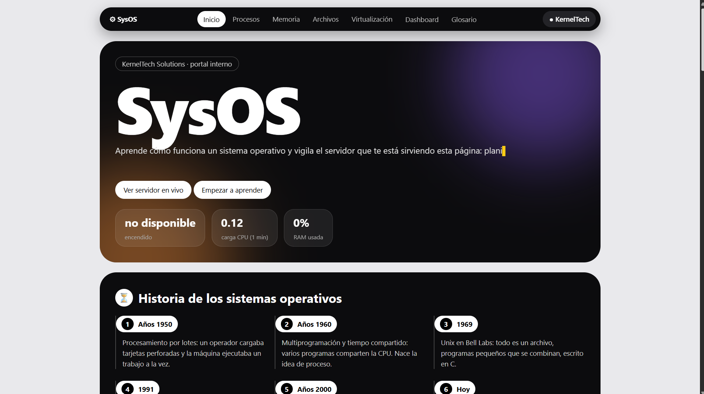
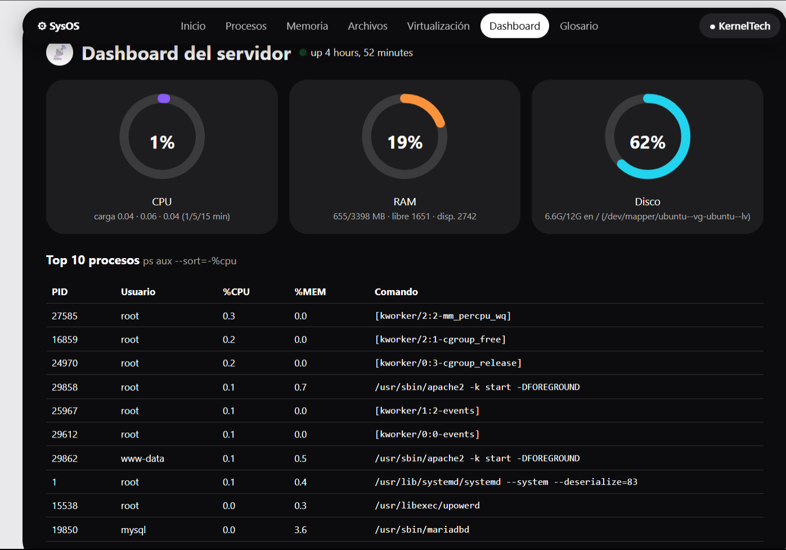
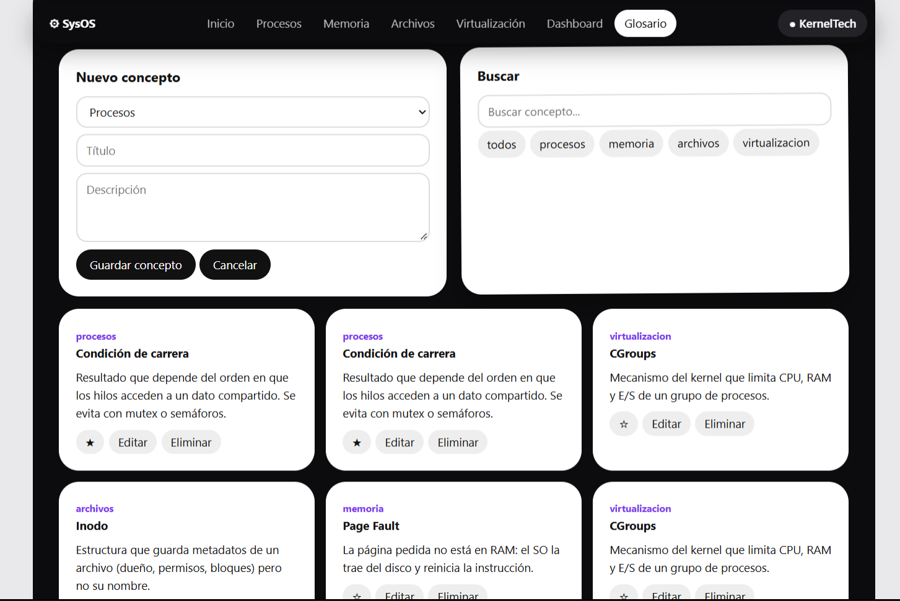
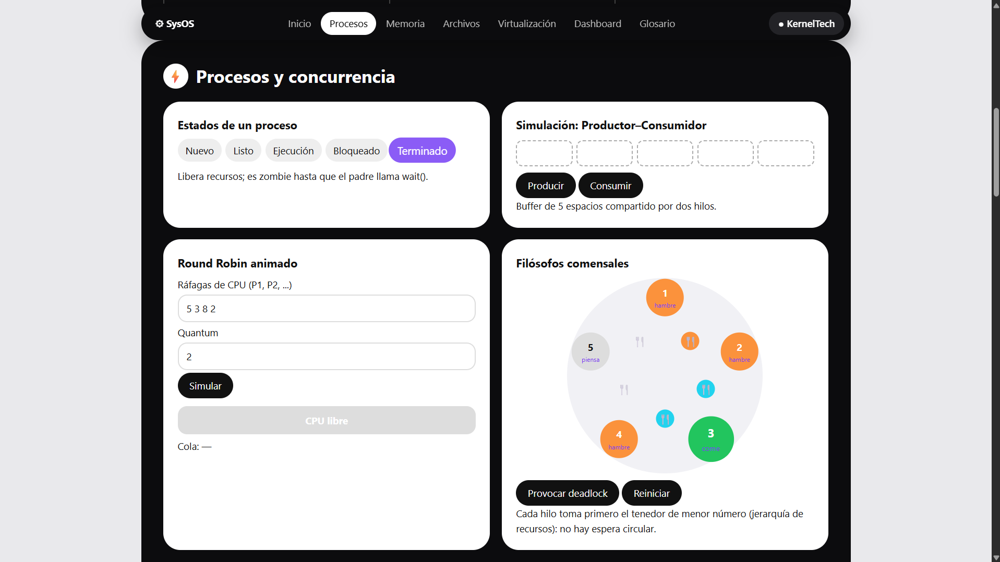
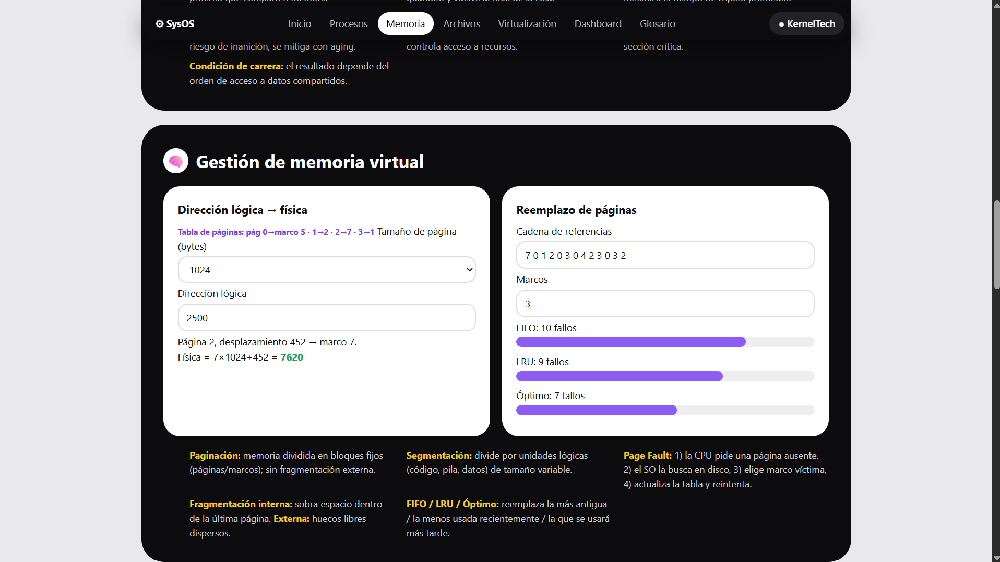

# SysOS – Interactive Portal \& Server Dashboard

Proyecto de **Sistemas Operativos** (UMG) para *KernelTech Solutions*.
Portal web educativo sobre Sistemas Operativos + dashboard que muestra métricas **en vivo** del servidor Linux que lo aloja + CRUD de conceptos guardado en **MariaDB**.

* **Autor:** Helen — Ingeniería en Sistemas, Universidad Mariano Gálvez
* **Entorno:** Ubuntu Server 26.04 LTS (VirtualBox) · Apache2 · PHP · MariaDB
* **Dominio local:** `http://sysos.local`

## 1\. Qué incluye

|Módulo|Contenido|
|-|-|
|Portal educativo|Historia de los SO; procesos y concurrencia (estados, Round Robin animado, Productor-Consumidor, Filósofos Comensales); memoria virtual (conversión lógica→física, FIFO/LRU/Óptimo); sistemas de archivos y E/S; virtualización y contenedores|
|Dashboard|Uptime y carga (1/5/15 min), RAM, disco y top 10 de procesos, actualizado cada 3 s|
|Glosario CRUD|Crear, leer, actualizar y eliminar conceptos en MariaDB, con búsqueda, filtro por módulo y favoritos|

## 2\. Estructura del proyecto

```
/var/www/sysos\\\_portal/
├── index.html   # interfaz del portal (HTML)
├── style.css    # estilos y animaciones
├── app.js       # lógica del navegador (simulaciones, dashboard, CRUD)
├── api.php      # backend: métricas del sistema + CRUD con MariaDB
└── schema.sql   # (solo repositorio) crea la base de datos y datos de ejemplo
```

## 3\. Cómo funciona

1. El navegador abre `http://sysos.local`. El nombre se resuelve por `/etc/hosts` y la petición llega al **puerto 80**.
2. **Apache2** elige el VirtualHost `sysos\\\_portal.conf` según el nombre (`ServerName`) y entrega `index.html`, `style.css` y `app.js` desde `/var/www/sysos\\\_portal/`.
3. `app.js` corre en el navegador y llama a `api.php` con `fetch`:

   * `api.php?a=metrics` (dashboard, cada 3 s)
   * `api.php?a=list|save|fav|del` (CRUD)
4. Apache pasa `api.php` al intérprete **PHP**. Para las métricas, PHP usa `shell\\\_exec`, que crea un proceso hijo (`fork` + `execve`) con los comandos `uptime`, `free -m`, `df -h /` y `ps aux --sort=-%cpu | head -n 11`. Esos comandos leen `/proc` y piden datos al **kernel** mediante llamadas al sistema.
5. PHP convierte la salida a **JSON** y el navegador la dibuja (anillos y tabla).
6. Para el CRUD, PHP se conecta a **MariaDB** con PDO (consultas preparadas, para evitar inyección SQL) y devuelve JSON.

```
Navegador ──HTTP:80──> Apache2 ──> PHP ──shell\\\_exec──> uptime/free/df/ps ──> Kernel (/proc)
                                    └──PDO──> MariaDB
```

## 4\. Guía de despliegue (CLI)

> Reemplaza los bloques `PEGAR LOG` con la salida real de tu terminal.

### 4.1 Instalar servicios

```bash
sudo apt update \\\&\\\& sudo apt upgrade -y
sudo apt install apache2 php libapache2-mod-php php-mysql mariadb-server -y
```

`php-mysql` es el driver que permite a PHP hablar con MariaDB.

### 4.2 Copiar el proyecto y asignar permisos

```bash
sudo mkdir -p /var/www/sysos\\\_portal
sudo cp index.html style.css app.js api.php /var/www/sysos\\\_portal/
sudo chown -R www-data:www-data /var/www/sysos\\\_portal
sudo find /var/www/sysos\\\_portal -type d -exec chmod 755 {} \\\\;
sudo find /var/www/sysos\\\_portal -type f -exec chmod 644 {} \\\\;
```

Propietario `www-data` (usuario con el que corre Apache), 755 en directorios y 644 en archivos (nunca 777).

### 4.3 Crear la base de datos

```bash
sudo systemctl enable --now mariadb
sudo mysql < schema.sql
```

Crea la base `sysos`, la tabla `conceptos`, 4 registros de ejemplo y el usuario `sysos`. Ejecuta `schema.sql` **una sola vez** (si no, se duplican los datos de ejemplo).

### 4.4 VirtualHost

```bash
sudo nano /etc/apache2/sites-available/sysos\\\_portal.conf
```

```apache
<VirtualHost \\\*:80>
    ServerName sysos.local
    DocumentRoot /var/www/sysos\\\_portal
    <Directory /var/www/sysos\\\_portal>
        Options -Indexes +FollowSymLinks
        AllowOverride All
        Require all granted
    </Directory>
</VirtualHost>
```

`-Indexes` desactiva el listado automático de directorios.

```bash
sudo a2ensite sysos\\\_portal.conf
sudo a2dissite 000-default.conf
sudo apache2ctl configtest
sudo systemctl reload apache2
```

### 4.5 Dominio local

```bash
echo "127.0.0.1 sysos.local" | sudo tee -a /etc/hosts
```

Para abrirlo desde Windows, agrega `IP\\\_DE\\\_LA\\\_VM  sysos.local` en `C:\\\\Windows\\\\System32\\\\drivers\\\\etc\\\\hosts`.

### 4.6 Firewall

```bash
sudo ufw allow OpenSSH      # solo si administras la VM por SSH
sudo ufw allow 'Apache'     # perfil que abre solo el puerto 80
sudo ufw enable
```

### 4.7 Permitir que el dashboard lea /proc

Apache corre con el sandbox de systemd (`ProtectProc=invisible`, `ProcSubset=pid`), que oculta archivos como `/proc/uptime` y `/proc/meminfo`. Sin este ajuste, el dashboard no muestra RAM, uptime ni procesos.

```bash
sudo mkdir -p /etc/systemd/system/apache2.service.d
printf '\\\[Service]\\\\nProcSubset=all\\\\nProtectProc=default\\\\n' | sudo tee /etc/systemd/system/apache2.service.d/override.conf
sudo systemctl daemon-reload
sudo systemctl restart apache2
systemctl show apache2 -p ProcSubset -p ProtectProc
```

## 5\. Verificación (logs)

**Apache activo**

```bash
sudo systemctl status apache2 --no-pager
```

**Sintaxis correcta**

```bash
sudo apache2ctl configtest
```

**Sitio activo y dominio virtual**

```bash
ls /etc/apache2/sites-enabled/
curl -I http://sysos.local
```

**Permisos**

```bash
ls -l /var/www/sysos\\\_portal
```

**Firewall**

```bash
sudo ufw status
```

**Directorios sin indexado** (crea una carpeta vacía y ábrela en el navegador)

```bash
sudo mkdir /var/www/sysos\\\_portal/prueba
curl -I http://sysos.local/prueba/
sudo rmdir /var/www/sysos\\\_portal/prueba
```

**Dashboard (API de métricas)**

```bash
curl -s http://sysos.local/api.php?a=metrics | head -c 400
```

**MariaDB**

```bash
sudo mysql sysos -e "SELECT id,modulo,titulo FROM conceptos;"
```

## 6. Capturas

### Portal


### Dashboard


### CRUD




## 7. Problemas encontrados y soluciones

|Problema|Causa|Solución|
|-|-|-|
|Glosario mostraba "Sin conexión a la base de datos"|Faltaba el driver `php-mysql`|`sudo apt install php-mysql` y reiniciar Apache|
|Dashboard sin RAM, uptime ni procesos (`uptime: Cannot get system uptime`)|El sandbox de systemd ocultaba `/proc` a Apache|Archivo `override.conf` con `ProcSubset=all` y `ProtectProc=default`|
|Conceptos de ejemplo duplicados|`schema.sql` se ejecutó dos veces|Eliminar duplicados con SQL; ejecutarlo una sola vez|

## 8\. Seguridad aplicada

* Permisos 755/644 con propietario `www-data` (sin 777).
* `Options -Indexes` para evitar el listado de directorios.
* UFW activo permitiendo solo tráfico web (puerto 80) y SSH si se necesita.
* Consultas SQL preparadas (PDO) y escape de HTML en el navegador.
* Los comandos de `shell\\\_exec` son fijos: no reciben datos del usuario.
* Mejoras futuras: login para el CRUD, credenciales fuera del código y HTTPS.

## 9\. Tecnologías

HTML5, CSS3, JavaScript, PHP, MariaDB, Apache2, Ubuntu Server, UFW, systemd, Git.

